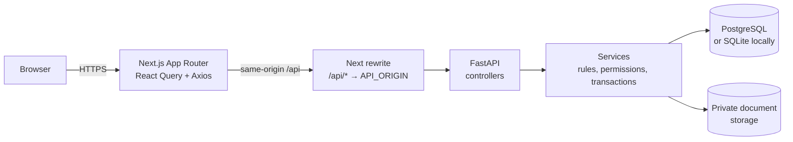
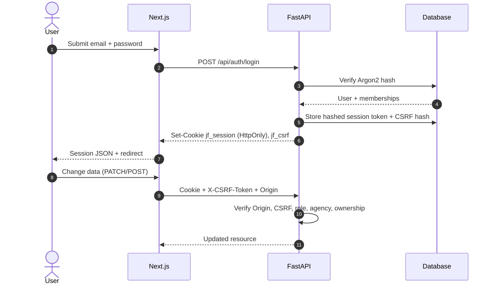
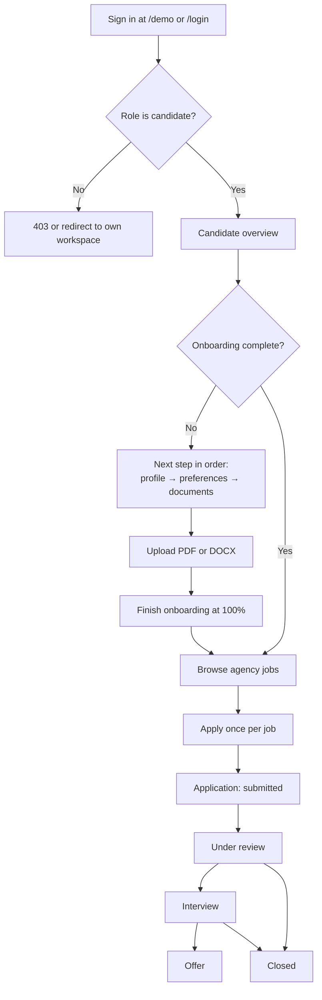
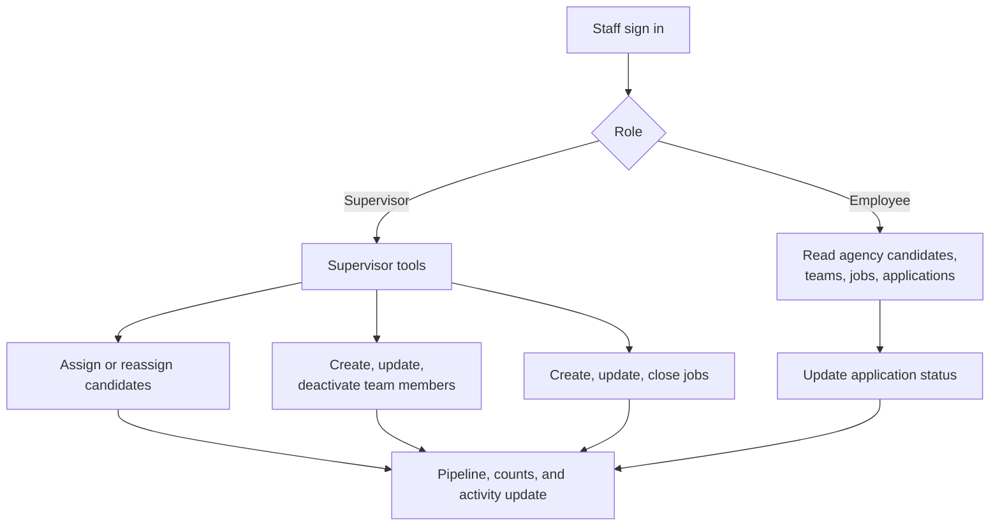
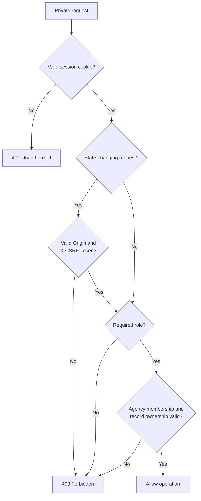
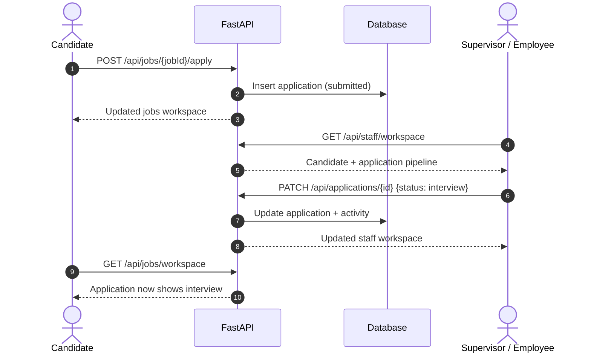
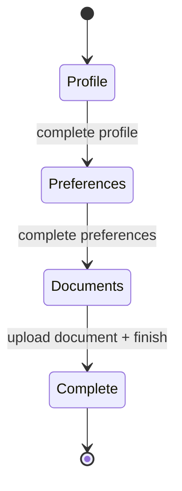
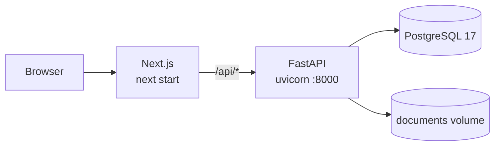

# System and workflow diagrams

Mermaid diagrams for the implemented prototype. Render them in GitHub, GitLab, VS Code (Mermaid preview), or [mermaid.live](https://mermaid.live).

## 1. Runtime architecture

## 2. Sign-in and CSRF sequence

## 3. Candidate journey

## 4. Staff and supervisor responsibilities

## 5. Request authorization decision

## 6. Cross-role application update

## 7. Onboarding state

Completing a step out of order is rejected with `409`. Editing an already completed profile or preference step remains allowed.

## 8. Deployment

`compose.yaml` runs PostgreSQL and the API; the API container applies Alembic migrations before starting. The Docker/PostgreSQL path is authored but unexecuted on this workstation; local verification uses SQLite.
